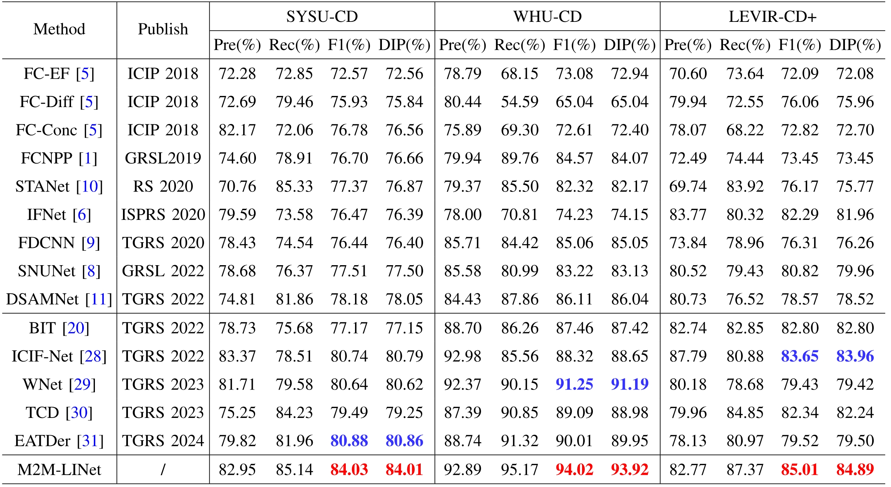
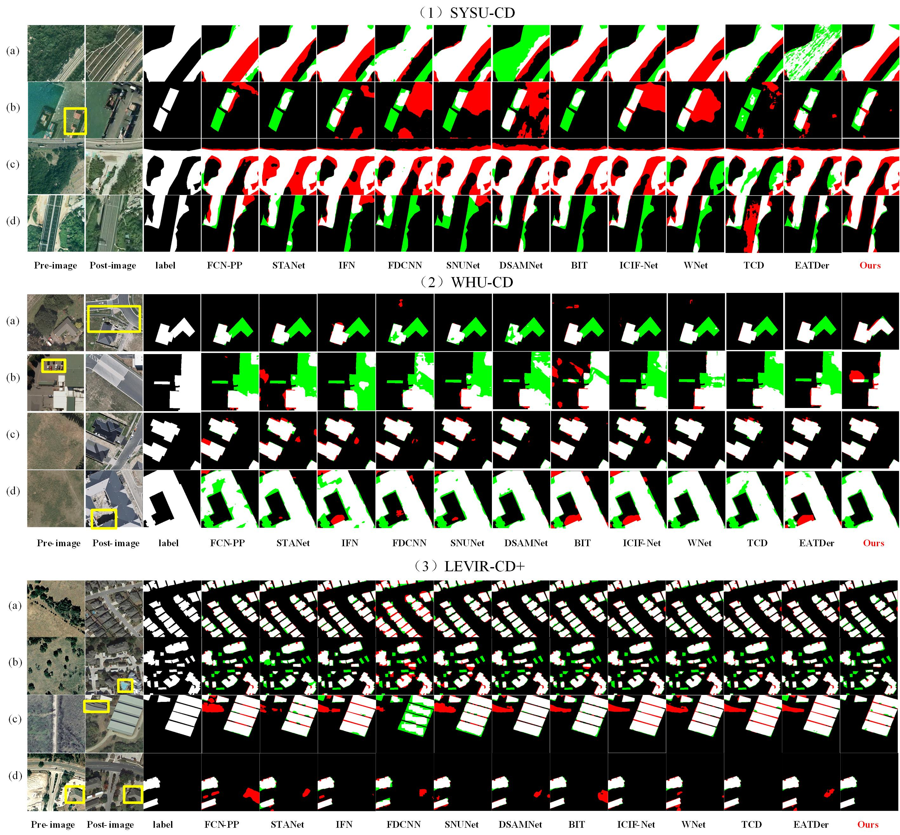

# M2M-LINet

面向遥感影像二值变化检测的轻量级交错网络，支持 CPU 与单卡 CUDA。

论文：[From Macro to Micro: A Lightweight Interleaved Network for Remote Sensing Image Change Detection](https://doi.org/10.1109/TGRS.2025.3548562)，IEEE Transactions on Geoscience and Remote Sensing，2025。

## 网络结构

网络由粗定位、交错细节提取和解码预测三个阶段组成，结合 PVTv2-B0、轻量卷积块 LCB、轻量 Transformer 块 LTB 与边界增强模块 BAEM。


## 项目结构

```text
M2M-LINet/
├── m2m_linet/
│   ├── models/
│   ├── data.py
│   ├── losses.py
│   ├── metrics.py
│   ├── checkpoint.py
│   ├── engine.py
│   └── cli.py
├── pretrained/[README.md](README.md)
├── temp/
├── tests/
├── train.py
├── evaluate.py
└── predict.py
```

## 数据集

| 数据集 | 简介 |
| --- | --- |
| [SYSU-CD](https://github.com/liumency/SYSU-CD) | 覆盖建筑、道路、植被等多种目标的遥感变化检测数据集。 |
| [WHU-CD](https://study.rsgis.whu.edu.cn/pages/download/building_dataset.html) | 面向建筑变化检测的高分辨率遥感数据集。 |
| [LEVIR-CD+](https://justchenhao.github.io/LEVIR/) | 面向建筑变化检测的双时相遥感影像数据集。 |

## 环境与数据准备

使用 Python 3.9 或以上，在项目根目录安装依赖：

```bash
python -m pip install -r requirements.txt
```

将 PVTv2-B0 预训练权重放在 `pretrained/pvt_v2_b0.pth`；下载与校验方法见 [预训练权重说明](pretrained/README.md)。

数据按以下结构组织，每个划分包含 `A`、`B`、`label` 三个目录：

```text
DATA_ROOT/
├── train/
│   ├── A/
│   ├── B/
│   └── label/
├── val/
│   ├── A/
│   ├── B/
│   └── label/
└── test/
    ├── A/
    ├── B/
    └── label/
```

也支持 `time1/time2` 命名。影像与标签按文件主名配对；标签使用 `{0,1}` 或 `{0,255}`，1/白色表示变化。输入高、宽均为 32 的倍数且至少为 64，建议裁为 256 × 256。各划分可额外提供 `edge/` 边缘标签，缺省时由变化标签自动生成。

## 训练与恢复

```bash
python train.py --data-root /path/to/DATA_ROOT --output-dir runs/experiment
```

默认训练 200 epoch，batch size 为 16，使用 AdamW，学习率为 `1e-4`，weight decay 为 `5e-4`。每轮使用独立的 `val` 验证集，以变化类 F1 保存 `best.pt`，并将最新训练状态保存为 `last.pt`。

```bash
python train.py --data-root /path/to/DATA_ROOT --output-dir runs/experiment --resume runs/experiment/last.pt
```

恢复时使用原输出目录，并保持原训练参数一致；`--epochs` 表示目标总轮数。其他参数见 `python train.py --help`。

## 论文实验结果

以下为原项目提供的论文定量对比与可视化结果。





## 来源与引用

本项目基于 [Sean1005-x/M2M-LINet](https://github.com/Sean1005-x/M2M-LINet) 整理，保留原作者署名和论文引用。

```bibtex
@ARTICLE{10912653,
  author={Xu, Yetong and Lei, Tao and Ning, Hailong and Lin, Shaoxiong and Liu, Tongfei and Gong, Maoguo and Nandi, Asoke K.},
  journal={IEEE Transactions on Geoscience and Remote Sensing},
  title={From Macro to Micro: A Lightweight Interleaved Network for Remote Sensing Image Change Detection},
  year={2025},
  volume={63},
  pages={1-14},
  doi={10.1109/TGRS.2025.3548562}
}
```
